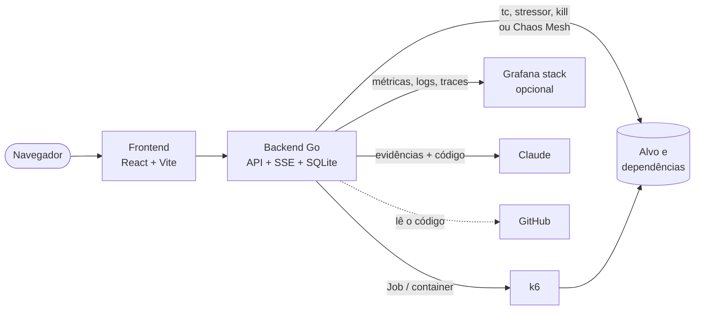

<div align="center">

# 🔥 new-app-chaos

**Teste de carga + chaos engineering + IA, numa tela só.**

Suba carga com k6, injete falhas no meio do teste e receba uma nota de resiliência
e uma análise da IA dizendo o que quebrou, por quê e onde corrigir no código.

[](https://github.com/mtsrodrigues4991/new-app-chaos/actions/workflows/ci.yml)


<sub>Nome provisório.</sub>

</div>

---

## O que ele faz

| | |
|---|---|
| 📈 **Carga** | Monte os endpoints e o perfil (rampa, patamar, pico). O k6 roda e os gráficos aparecem ao vivo: latência p50/p95/p99, RPS, erros, CPU e memória do alvo. |
| 💥 **Caos** | Arraste falhas numa linha do tempo: latência, perda de pacotes, CPU, memória e kill. No Kubernetes também falhas de disco, DNS e HTTP, inclusive em dependências como o Postgres. |
| 🎯 **Veredito** | SLOs editáveis e uma nota de resiliência de 0 a 100 (inspirada no Resiliency Score do krkn), sem IA e reproduzível. |
| 🤖 **IA** | Relatório sob demanda com ponto de quebra, causas e correções que apontam arquivo e linha do seu repositório. Compara com uma execução de referência e tem chat por execução. |
| 🔭 **Observabilidade** | Opcional: Grafana com Prometheus, Loki, Tempo e Pyroscope. Heap, GC, traces lentos e profiling entram na análise. |

Detalhes de cada funcionalidade em [docs/funcionalidades.md](docs/funcionalidades.md).

---

## Como rodar

Escolha onde quer rodar:

| Modo | Onde | Alvos | Falhas | Melhor para |
|---|---|---|---|---|
| 🐳 **[Docker](#docker-local)** | Sua máquina | Containers Docker | 5 básicas | Começar em 1 minuto |
| ☸️ **[Kubernetes local](#kubernetes-local-kind)** | Sua máquina (KIND) | Deployments | 5 básicas + disco, DNS, HTTP, dependências | Testar o modo Kubernetes completo |
| ☁️ **[Azure](#azure-aks)** | AKS, URL pública com login | Deployments | Igual ao Kubernetes local | Demonstrar para outras pessoas |

> Em todos os modos, a IA precisa de uma chave da Anthropic. Sem ela, todo o resto funciona.

### Docker (local)

**Requisitos:** Docker com Compose.

```bash
git clone https://github.com/mtsrodrigues4991/new-app-chaos.git && cd new-app-chaos
cp .env.example .env          # opcional: preencha ANTHROPIC_API_KEY para a IA
docker compose up --build
```

| Endereço | O que é |
|---|---|
| http://localhost:3000 | Interface. Comece em **Alvos → Criar cenário** no `demo-api` |
| http://localhost:8080/api/health | Backend |
| http://localhost:8081/items | API de exemplo ([collection do Postman](examples/demo-api/postman_collection.json)) |

<details>
<summary>Dicas e problemas comuns</summary>

- **Zerar os dados:** `docker compose down -v` (o histórico fica no volume `app-data`).
- **Primeira execução demora:** o backend baixa a imagem `grafana/k6` (cerca de 1 minuto).
- **Erro "o kernel desta máquina não tem o módulo netem":** rode `sudo modprobe sch_netem`. Para valer a cada boot no WSL, adicione `sch_netem` em `/etc/modules-load.d/`.
- **Repositório privado na análise:** coloque no `.env` um `GITHUB_TOKEN` fine-grained só com *Contents: Read-only*. Repositórios públicos não precisam de token.
- **Custo da IA:** uma execução de 1 minuto manda uns 6 mil tokens. As longas são agrupadas e ficam perto de 20 mil.

</details>

### Kubernetes local (KIND)

**Requisitos:** Docker, `make`, `git` e cerca de 6 GB de RAM livres (no WSL, ajuste `memory=` no `.wslconfig`).

```bash
make kind-tools        # instala kind, kubectl e helm em ~/.local/bin (só na primeira vez)
make kind-up           # cria o cluster com Chaos Mesh, o app e todos os alvos
make kind-up OBS=1     # o mesmo, com a stack Grafana (mais ~2 GB de RAM)
```

Abra http://localhost:3000. Para o Grafana, use o botão **Grafana** na barra lateral (http://localhost:3000/grafana/).

| Comando | O que faz |
|---|---|
| `make kind-app` | Reconstrói e reinstala só o app, depois de mudar o código |
| `make kind-down` | Apaga o cluster e o banco que estava nele |
| `make test` | Testes do backend e checagem de tipos do frontend |

**Alvos instalados**, com a URL base para usar no cenário:

| Alvo | Namespace | URL base |
|---|---|---|
| demo-api | `demo` | `http://demo-api.demo:8080` |
| pix-api + pix-postgres | `pix` | `http://pix-api.pix:8080` ([itau-case-pix](https://github.com/mtsrodrigues4991/itau-case-pix)) |
| svc-pedido, svc-pagamento, svc-catalogo | `dorigao` | `http://svc-pedido.dorigao:8080` (`/api/pedido`, `/api/pagamento`, `/api/catalogo`) |

<details>
<summary>Opções e problemas comuns</summary>

- **Porta 3000 ocupada:** pare o compose (`docker compose down`) ou use `UI_PORT=3001 make kind-up`.
- **Usar um clone que você já tem:** `PIX_DIR=~/itau-case-pix make kind-up`. Os outros repositórios são clonados em `.targets/`.
- **Instalar só alguns alvos:** `TARGETS="demo-api pix" make kind-up`.
- **Chaves:** o script lê só `ANTHROPIC_API_KEY` e `GITHUB_TOKEN` do `.env` e cria um Secret no cluster.
- **Conferir uma falha por fora:** `kubectl get networkchaos,stresschaos,podchaos -A` durante a execução.
- **Falhas HTTP no WSL2:** não são aplicadas, porque o kernel do WSL2 não tem o módulo `ebtables`. Na Azure funcionam.
- **Desligar o Grafana:** rode `make kind-up` sem `OBS=1`. Para apagar a stack, use `kubectl delete ns observability`.

</details>

### Azure (AKS)

O ambiente fica na Azure com HTTPS e login, e liga e desliga por botões no GitHub Actions. Ligado custa cerca de **US$ 0,55/h**. Desligado sobra só a base (IP fixo, registry e estado), cerca de **US$ 4/mês**.

**Para ligar:** em **Actions → Azure - Ligar ambiente → Run workflow**. Leva uns 20 minutos, e o endereço aparece no resumo da execução:

> https://new-app-chaos-aa7c69.eastus2.cloudapp.azure.com

**Para desligar:** em **Actions → Azure - Desligar ambiente → Run workflow**. Para desligar sozinho todo dia às 2h (Brasília), crie a variável de repositório `AUTO_DOWN=true`.

**Login:** o usuário `mateus` usa a senha do secret `ADMIN_PASSWORD`. Ele cria contas para convidados em **Usuários**, dentro do app. O login também protege a API e o Grafana.

<details>
<summary>Configurar do zero numa assinatura nova</summary>

1. No Azure Cloud Shell, rode [`scripts/azure-setup.sh`](scripts/azure-setup.sh). Ele cria a identidade do GitHub Actions (OIDC, dona só do resource group) e mostra a cota de vCPU da região.
2. Troque `AZURE_CLIENT_ID`, `AZURE_TENANT_ID` e `AZURE_SUBSCRIPTION_ID` nos workflows `azure-up.yml` e `azure-down.yml`.
3. Crie os secrets do repositório:

   | Secret | Obrigatório | Para quê |
   |---|---|---|
   | `ADMIN_PASSWORD` | sim | Senha do administrador |
   | `ANTHROPIC_API_KEY` | para a IA | Análise e chat |
   | `CODE_GITHUB_TOKEN` | não | IA lendo repositórios privados |
   | `APP_USERS` | não | Contas extras, uma por linha, no formato `nome:senha` |

4. Rode **Azure - Ligar ambiente**.

</details>

<details>
<summary>Recursos criados na Azure</summary>

| Recurso | Nome | Fica quando desliga? |
|---|---|---|
| Resource group | `new-app` | ✅ |
| IP público + DNS | `new-app-chaos-ingress` | ✅ |
| Container Registry | `newappchaos<sufixo>` | ✅ |
| Storage (estado do Terraform e backup do HTTPS) | `nacstate<sufixo>` | ✅ |
| Identidade do cluster | `new-app-chaos-cluster` | ✅ |
| Orçamento (alerta de US$ 30) | `new-app-chaos` | ✅ |
| AKS (Free) | `new-app-chaos` | ❌ |
| ↳ pool `apps`: app e alvos | 2× Standard_D4as_v4 | ❌ |
| ↳ pool `obs`: Grafana | 1× Standard_D2as_v4 | ❌ |
| ↳ pool `load`: k6 (spot) | 1× Standard_D2as_v4 | ❌ |
| VMs e discos do AKS | RG `new-app-nodes` | ❌ |

Com o cluster ligado: `az aks get-credentials -g new-app -n new-app-chaos`.
A infraestrutura está em [`infra/azure`](infra/azure) (Terraform) e a instalação em [`scripts/azure-deploy.sh`](scripts/azure-deploy.sh).

</details>

### Desenvolvimento sem Docker

<details>
<summary>Backend e frontend direto na máquina</summary>

```bash
# backend (Go 1.25+). As falhas precisam do stressor e de uma imagem com tc
# (a do próprio backend serve: docker compose build backend).
cd backend && go build -o /tmp/stressor ./cmd/stressor
STRESSOR_PATH=/tmp/stressor TOOLS_IMAGE=new-app-chaos-backend go run ./cmd/server

# frontend (Node 22+)
cd frontend && npm install && npm run dev
```

</details>

---

## Arquitetura



<details>
<summary>Estrutura de pastas</summary>

```
backend/             API em Go
  cmd/server/        ponto de entrada
  cmd/stressor/      gerador de CPU/memória copiado para dentro do alvo
  internal/api/      rotas REST, stream ao vivo (SSE) e limites de uso
  internal/auth/     login, sessões e usuários
  internal/runner/   orquestra cada execução, nas plataformas Docker e Kubernetes
  internal/chaos/    falhas no Docker (tc netem, stressor, kill)
  internal/chaosmesh/ falhas no Kubernetes via Chaos Mesh
  internal/verdict/  SLOs e nota de resiliência
  internal/analysis/ evidências, relatório e chat da IA
  internal/ai/       provedor de IA trocável (Claude no MVP)
  internal/coderepo/ leitura do código da aplicação no GitHub
  internal/store/    SQLite
frontend/            React + TypeScript + Vite
examples/demo-api/   API de exemplo
deploy/              KIND, charts Helm, alvos e observabilidade
infra/azure/         Terraform da Azure
scripts/             kind-up/down e azure-*
docs/                especificação e funcionalidades
```

</details>

---

## Roadmap e backlog

### ✅ Feito

- **MVP (Docker):** esqueleto, carga com k6 e gráficos ao vivo, 5 falhas numa linha do tempo arrastável, veredito com nota, análise e chat com IA, relatório imprimível e IA lendo o código no GitHub.
- **MVP2 (Kubernetes local):** KIND + Helm, falhas pelo Chaos Mesh, falhas em dependências, disco, DNS e HTTP, logs e eventos do Kubernetes na IA, stack Grafana opcional, visual novo.
- **MVP plus (Azure):** AKS com URL pública, HTTPS e login, liga e desliga pelo GitHub Actions, k6 em nó spot separado e Grafana isolado dos alvos.

### 📋 Backlog

**Próximo**
- [ ] **MVP3: VMs.** Rodar carga e caos em máquinas virtuais via SSH.

**Produto**
- [ ] Curva de carga desenhável (arrastar os pontos do gráfico de VUs)
- [ ] Falhas combinadas (mais de uma ao mesmo tempo)
- [ ] Falhas de banda e falhas na entrada (ingress)
- [ ] Falhas de disco e DNS também no modo Docker
- [ ] Listas mais ricas e editor de cenário estilo editor de vídeo
- [ ] Instrumentação OpenTelemetry nos alvos svc-* da Dorigao

**Nuvem**
- [ ] Histórico persistente na Azure (hoje some ao desligar)
- [ ] Domínio próprio
- [ ] Perfis de acesso (hoje quem entra pode tudo)
- [ ] AWS (EKS)
- [ ] krkn como motor opcional para falhas de nó e zona

**Plataforma**
- [ ] Outros provedores de IA
- [ ] CLI para rodar cenários no CI
- [ ] SaaS / open source

---

<sub>Especificação completa (visão, arquitetura e modelo de dados) em [docs/especificacao.md](docs/especificacao.md).</sub>
