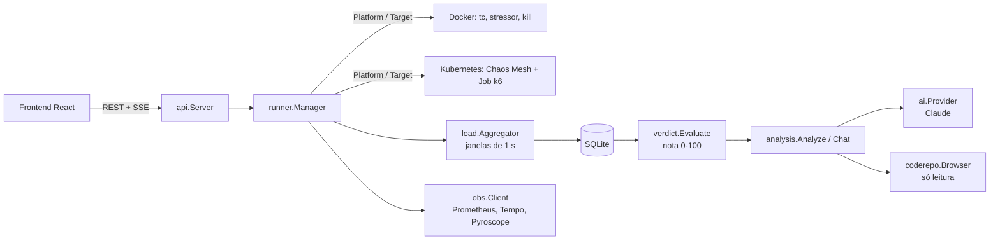
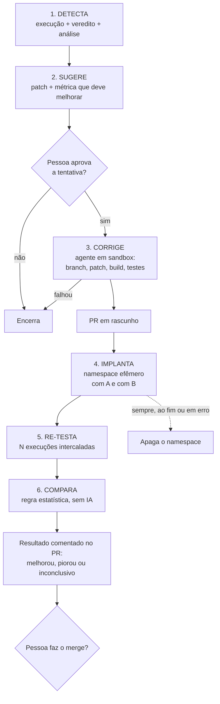

# Análise de evolução do new-app-chaos

Data: 16/11/2026 · Commit analisado: `4ace3b7` (branch `main`)

Este documento avalia o projeto contra a visão do produto e propõe o caminho até o ciclo
"detecta → sugere → corrige → re-testa → compara".

> **Andamento (16/11/2026):** as **Fases 0 (medição confiável) e 1 (antes e depois com estatística) estão concluídas**. O que foi
> entregue, o critério de pronto conferido e os desvios do plano estão na [seção 6](#6-roadmap-em-fases); os
> resultados medidos estão em [resultados/](resultados/).
> As seções 1 e 2 descrevem o código como estava no commit `4ace3b7`, antes da fase; as lacunas que ela
> fechou estão marcadas na seção 2.

**Visão usada como régua (quatro pilares):**

1. Executar testes de carga e de caos contra APIs.
2. Usar IA para analisar os resultados.
3. Ler o código da aplicação testada e sugerir melhorias de eficiência e confiabilidade.
4. (Futuro) Um espaço isolado onde um agente aplica a correção, roda o teste de novo e compara antes e depois.

**Como ler as referências:** cada afirmação sobre o código traz um link `arquivo:linha`. O que não foi
verificado no código ou num teste aparece marcado como **Hipótese**.

## Resumo

- **Os pilares 1, 2 e 3 existem e funcionam.** O pilar 4 não tem código, mas tem três peças prontas para
  apoiá-lo: a execução de referência, a seção de regressão do relatório e a sugestão de correção com arquivo e linha.
- **O maior bloqueio do pilar 4 é a medição, não o agente.** Hoje a comparação é uma execução contra outra,
  julgada pela IA em texto. A carga usa um número fixo de usuários virtuais, então a vazão muda quando a
  latência muda. Não há métrica por endpoint nem registro de qual versão da aplicação foi testada.
  Sem resolver isso, um "antes e depois" não prova nada.
- **Há uma brecha de segurança no modo nuvem.** A trava de alvos confere só o host da URL base. O namespace
  do alvo e o das dependências não são conferidos, e o backend tem permissão de criar falhas em todo o cluster.
- **Recomendação de MVP:** primeiro a comparação estatística com você implantando a versão corrigida à mão
  (fases 0 e 1). O agente que altera código entra depois, sobre uma medição em que dá para confiar.

## Suposições registradas

| # | Suposição | Motivo |
|---|---|---|
| S1 | O ambiente alvo é Kubernetes genérico. AKS e KIND são os ambientes reais de hoje; OpenShift e EKS são destinos futuros. | O campo "Ambiente alvo" do pedido veio com o texto de exemplo, sem preenchimento. |
| S2 | O modo Docker continua suportado, mas o pilar 4 nasce só no Kubernetes. | Isolar um ambiente por experimento é natural com namespaces; no Docker exigiria outro desenho. |
| S3 | O código das aplicações alvo fica no GitHub. | É o único provedor que o leitor de código conhece ([fetch.go:131-180](../backend/internal/coderepo/fetch.go#L131-L180)). |
| S4 | Pulei a entrevista prevista no CLAUDE.md. | O pedido mandou seguir a leitura mais razoável e registrar as suposições. |
| S5 | O MVP3 (VMs via SSH) fica fora desta análise. | Ele não aproxima nenhum dos quatro pilares. A decisão de adiá-lo é sua (seção 6). |

**O que foi executado:** `go vet ./...` e `go test ./...` passaram em todos os pacotes do backend (rodados
num container `golang:1.25`, porque o WSL não tem Go instalado). O `tsc --noEmit` do frontend **não foi
executado**: não há `node_modules` nem Node no WSL.

## Verificação nos ambientes reais (16/11/2026)

Depois da análise do código, conferi as suposições e hipóteses no KIND local e na assinatura da Azure.
Só usei comandos de leitura, mais um k6 de 6 segundos sem alvo HTTP. Nenhuma falha foi injetada.

**KIND local** (`kind-new-app-chaos`, um nó, Kubernetes 1.33.1, no ar há 5 dias):

| O que o documento afirma | Resultado | Evidência |
|---|---|---|
| S1: KIND e AKS são os ambientes reais | **Confirmado** | O cluster KIND existe com `demo`, `pix`, `dorigao`, `chaos-mesh` e `observability`; a AKS `new-app-chaos` existe no RG `new-app`. |
| L12: o backend pode criar falhas e apagar pods em qualquer namespace | **Confirmado** | `kubectl auth can-i` com a conta de serviço do backend respondeu `yes` para criar `podchaos` em `kube-system`, criar `networkchaos` em `chaos-mesh` e apagar pods em `kube-system`. |
| L9: o backend não consegue implantar versões | **Confirmado** | A mesma conta respondeu `no` para criar ou alterar Deployments, criar namespaces e ler Secrets. |
| L11: a trava de alvos | **Confirmado no código; não exercitado** | No KIND a trava está desligada (o backend não tem `ALLOWED_TARGET_HOSTS`), como previsto para o modo local. O teste real pede o app da Azure no ar. Não disparei um kill em `kube-system` para provar. |
| L7: `requests` menores que `limits` nos alvos | **Confirmado, e é geral** | Todos os pods de `pix`, `demo` e `dorigao` estão na classe `Burstable`. O nó tem 110% de CPU em `limits` (13,3 núcleos prometidos). |
| L7: metrics-server a cada 15 s | **Confirmado** | O metrics-server roda com `--metric-resolution=15s`. |
| L7: sem autoscaling atrapalhando | **Confirmado** | Não há nenhum HPA no cluster. |
| L1: uma diferença pequena pode ser ruído | **Confirmado com dados seus** | Cinco execuções com as mesmas falhas contra o `pix-api` (cenários `fase-c-pix-logs`, `-v2`, `-v3` e duas de `fase-d-pix-obs`) deram notas 60, 61, 61, 62 e 63. A nota da falha de kill variou de 69 a 79, e a mediana da sonda de 8,1 a 10,2 ms. A aplicação não mudou entre elas. |
| L6: não há repetição do mesmo cenário | **Confirmado** | Das 14 execuções guardadas, nenhum cenário tem duas execuções concluídas. Para repetir, você clonou o cenário. |
| O3: o dashboard do k6 0.54 publica `Trend` personalizados | **Confirmado** (era hipótese) | Um script de teste com dois `Trend` recebeu, a cada segundo, avg, max, med, min, p90, p95 e p99 de cada um. |
| L5: os percentis da execução inteira não existem | **Corrigido: existem e são ignorados** | O dashboard também emite um evento `cumulative`, com os agregados desde o início. O leitor só trata `param`, `metric`, `start`, `stop` e `snapshot` ([dashboard.go:47-96](../backend/internal/load/dashboard.go#L47-L96)). Não é preciso tirar o `--no-summary`. |
| 4.1: a métrica HTTP traz a rota | **Confirmado** (era hipótese) | `http_server_request_duration_seconds_count` tem o rótulo `http_route`, com os valores `/**` e `/api/v1/pix-keys/{id}`. |
| O8: dá para montar o mapa de dependências pelos traces | **Confirmado, e mais simples que o previsto** | O Prometheus da stack já tem `traces_service_graph_request_total` com a aresta `pix-api` → `pix-postgres` (`connection_type="database"`). Não é preciso ler spans. |
| O8: só alvos instrumentados têm mapa | **Confirmado** | Só `pix-api` aparece como `service_name`. Os `svc-*` e o `demo-api` não aparecem. |
| O1: ler o commit pelo rótulo da imagem | **Refutado para as imagens de hoje** | As imagens `pix-api`, `demo-api` e `svc-pedido` não têm nenhum rótulo. O id da imagem existe nos pods. O O1 precisa incluir o rótulo no build dos alvos. |
| L16: dependências reais são StatefulSets | **Não confirmado aqui** | Não há nenhum StatefulSet no KIND; o Postgres é um Deployment. Continua hipótese para outros clusters. |
| 5.3: restringir a rede do agente com NetworkPolicy | **Não verificado no KIND** | Não há nenhuma NetworkPolicy no cluster. **Hipótese:** o `kindnetd` desta versão aplica NetworkPolicy. |

**Azure** (AKS `new-app-chaos`, Kubernetes 1.36.5, ligada pelo workflow durante a verificação):

| O que o documento afirma | Resultado | Evidência |
|---|---|---|
| Os recursos e pools descritos no README | **Confirmado** | O RG `new-app` tem storage, registry, IP público, identidade e a AKS Free. Pools: `apps` 2× D4as_v4, `obs` 1× D2as_v4 e `load` 1× D2as_v4. |
| L7: o k6 roda em nó spot que pode ser retomado | **Confirmado na configuração** | O pool `load` tem prioridade `Spot` e despejo `Delete`; o backend recebe `K6_NODE_SELECTOR=agentpool=load`. Não observei um despejo. |
| L12: o backend pode criar falhas em qualquer namespace | **Confirmado, e pior na nuvem** | A conta de serviço do backend pode criar `podchaos` em `kube-system` e em `traefik`, criar `networkchaos` em `cert-manager` e apagar pods em `kube-system`. São os namespaces que sustentam o HTTPS e a entrada do ambiente público. |
| L11: a trava da nuvem confere só o host da URL | **Confirmado na configuração; não exercitado** | O backend da AKS tem `ALLOWED_TARGET_HOSTS=demo,pix,dorigao` e nenhuma variável de namespaces. Não testei pela API: exigiria a senha de administrador e um kill real. |
| L10: teto de IA por chamadas | **Confirmado** | `AI_DAILY_LIMIT=60`. |
| L7: `requests` menores que `limits` | **Confirmado** | Todos os pods de `pix`, `demo`, `dorigao` e do próprio app estão na classe `Burstable`. |
| 5.3: restringir a rede do agente com NetworkPolicy | **Não funciona na AKS de hoje** | O cluster está com `networkPolicy: none`, e o Terraform não define o campo ([main.tf:125-129](../infra/azure/main.tf#L125-L129)). Não há Cilium, Calico nem azure-npm no `kube-system`. Uma NetworkPolicy seria aceita e ignorada. A fase 2 precisa ligar um motor de políticas. |
| O1: registrar o digest da imagem | **Viável na AKS** | Os pods mostram o digest do registry (`demo-api@sha256:…`) e o `pix-api` usa uma tag com cara de commit (`d4c145f82ff2`). |
| L16: dependências reais são StatefulSets | **Não confirmado aqui** | Não há nenhum StatefulSet na AKS. |

**Achado novo, fora das suposições: o `pix` não sobe na AKS.**
- `pix-postgres` está em `CrashLoopBackOff`, e o `pix-api` cai junto por não achar o banco.
- O log do Postgres diz: `initdb: error: directory "/var/lib/postgresql/data" exists but is not empty … It contains a lost+found directory`.
- Causa: o volume é montado direto na pasta de dados ([pix-postgres.yaml:11-14](../deploy/targets/pix-postgres.yaml#L11-L14)). O disco gerenciado da Azure vem formatado com a pasta `lost+found`, e o `initdb` recusa uma pasta que não está vazia. No KIND o volume é uma pasta local vazia, por isso lá funciona.
- Correção provável (não aplicada): apontar o `PGDATA` para uma subpasta do volume, por exemplo `/var/lib/postgresql/data/pgdata`.
- Efeito: enquanto isso, os cenários do `pix` não rodam na Azure, e as falhas de disco e em dependência não podem ser demonstradas lá.

---

## 1. Estado atual

### 1.1 Arquitetura

- **Uma interface separa o fluxo da plataforma.** `Platform` e `Target` definem resolver o alvo, subir o k6,
  ler CPU e memória, aplicar falha e recuperar o que sobrou ([platform.go:13-32](../backend/internal/runner/platform.go#L13-L32)). Docker e
  Kubernetes são as duas implementações ([runner.go:84-98](../backend/internal/runner/runner.go#L84-L98)).
- **A execução é uma goroutine por vez, em memória.** `Start` recusa uma segunda execução com `ErrBusy`
  ([runner.go:136-141](../backend/internal/runner/runner.go#L136-L141)). O fluxo completo está em `execute` ([runner.go:222-465](../backend/internal/runner/runner.go#L222-L465)).
- **O banco é SQLite com JSON em colunas de texto** e um único escritor
  ([store.go:46-101](../backend/internal/store/store.go#L46-L101), [store.go:109](../backend/internal/store/store.go#L109)).

### 1.2 Pilar 1: carga e caos

| Capacidade | Onde está | Observação |
|---|---|---|
| Modelo do cenário | [scenario.go:170-186](../backend/internal/scenario/scenario.go#L170-L186) | Alvo, endpoints, perfil, falhas, SLO, repositório. |
| Endpoints | [scenario.go:53-59](../backend/internal/scenario/scenario.go#L53-L59) | Método, caminho, corpo, cabeçalhos e peso, digitados à mão ([ScenarioEditor.tsx:337-396](../frontend/src/pages/ScenarioEditor.tsx#L337-L396)). |
| Perfis de carga | [scenario.go:324-358](../backend/internal/scenario/scenario.go#L324-L358) | Rampa, patamar e pico, sempre em número de VUs. |
| Script do k6 | [k6.go:17-87](../backend/internal/load/k6.go#L17-L87) | Gerado do cenário. Sorteia o endpoint pelo peso ([k6.go:65-73](../backend/internal/load/k6.go#L65-L73)). |
| Leitura das métricas | [dashboard.go:27-32](../backend/internal/load/dashboard.go#L27-L32) | Lê o formato interno do dashboard do k6, por segundo. |
| Janela por segundo | [aggregate.go:10-34](../backend/internal/load/aggregate.go#L10-L34) | p50, p95, p99, RPS, erro, códigos HTTP, VUs, CPU, memória, sonda, pods. |
| Falhas no Docker | [chaos.go:47-76](../backend/internal/chaos/chaos.go#L47-L76) | Latência, perda, CPU, memória e kill. |
| Falhas no Kubernetes | [chaosmesh.go:36-46](../backend/internal/chaosmesh/chaosmesh.go#L36-L46), [k8s.go:191-291](../backend/internal/runner/k8s.go#L191-L291) | Seis tipos do Chaos Mesh, com espera de confirmação da injeção. |
| Falha em dependência | [scenario.go:114-134](../backend/internal/scenario/scenario.go#L114-L134) | Outro Deployment, ou só o caminho do alvo até ele. |
| Linha do tempo | [runner.go:552-623](../backend/internal/runner/runner.go#L552-L623) | Aplica e reverte no horário e grava os instantes reais ([runner.go:594](../backend/internal/runner/runner.go#L594), [runner.go:608](../backend/internal/runner/runner.go#L608)). |
| Reversão garantida | [runner.go:101-117](../backend/internal/runner/runner.go#L101-L117), [k8s.go:57-84](../backend/internal/runner/k8s.go#L57-L84) | Limpa o que sobrou quando o backend sobe. O recurso do Chaos Mesh tem margem de 30 s ([chaosmesh.go:28](../backend/internal/chaosmesh/chaosmesh.go#L28)). |
| Sonda (só caos) | [probe.go:18-22](../backend/internal/probe/probe.go#L18-L22) | Um GET por segundo. |
| Veredito | [verdict.go:142-270](../backend/internal/verdict/verdict.go#L142-L270) | Nota de 0 a 100, sem IA, com pesos fixos ([verdict.go:21-32](../backend/internal/verdict/verdict.go#L21-L32)). |
| k6 fora dos alvos na nuvem | [k8s.go:319-325](../backend/internal/runner/k8s.go#L319-L325) | `nodeSelector` e `tolerations` vindos do ambiente. |

**Avaliação:** pilar maduro. A reversão garantida e o registro dos instantes reais das falhas são pontos fortes.

### 1.3 Pilar 2: análise por IA

| Capacidade | Onde está | Observação |
|---|---|---|
| Camada de provedor | [provider.go:55-58](../backend/internal/ai/provider.go#L55-L58) | Só a Anthropic implementa ([main.go:74](../backend/cmd/server/main.go#L74)). |
| Laço de ferramentas | [anthropic.go:105-165](../backend/internal/ai/anthropic.go#L105-L165) | Até 40 idas e voltas ([anthropic.go:99-102](../backend/internal/ai/anthropic.go#L99-L102)). |
| Cache das evidências | [anthropic.go:53-56](../backend/internal/ai/anthropic.go#L53-L56) | O bloco grande de evidências fica em cache entre perguntas. |
| Relatório estruturado | [report.go:81-117](../backend/internal/analysis/report.go#L81-L117) | JSON Schema: resumo, ponto de quebra, efeito por falha, causas, correções. |
| Evidências | [report.go:219-235](../backend/internal/analysis/report.go#L219-L235) | Série por segundo (até 600 linhas, [evidence.go:21](../backend/internal/analysis/evidence.go#L21)), logs, eventos, telemetria. |
| Regressão | [ai.go:85-98](../backend/internal/api/ai.go#L85-L98), [report.go:109-113](../backend/internal/analysis/report.go#L109-L113) | Compara com **uma** execução de referência; a IA responde "melhorou", "igual" ou "piorou". |
| Chat por execução | [ai.go:261-339](../backend/internal/api/ai.go#L261-L339) | Com o histórico das 15 últimas execuções do cenário ([ai.go:102](../backend/internal/api/ai.go#L102)). |
| Telemetria da aplicação | [obs.go:130-141](../backend/internal/obs/obs.go#L130-L141) | Heap, GC, threads, HTTP, pool do banco, traces e profiling. As consultas são voltadas à JVM. |
| Teto de uso | [guard.go:65-80](../backend/internal/api/guard.go#L65-L80) | Conta chamadas por dia, em memória. |

**Avaliação:** pilar maduro para diagnóstico de uma execução. A comparação entre execuções é fraca (seção 2, L1).

### 1.4 Pilar 3: leitura do código

| Capacidade | Onde está | Observação |
|---|---|---|
| Download do código | [fetch.go:131-180](../backend/internal/coderepo/fetch.go#L131-L180) | Baixa o commit atual do branch e guarda só o mais recente ([fetch.go:165-172](../backend/internal/coderepo/fetch.go#L165-L172)). |
| Ferramentas da IA | [tools.go:259-275](../backend/internal/coderepo/tools.go#L259-L275) | `list_dir`, `search_code` e `read_file`. Todas só de leitura. |
| Limites | [tools.go:21-28](../backend/internal/coderepo/tools.go#L21-L28) | 30 arquivos e 80 chamadas por análise. |
| Proteção de caminho | [tools.go:43-50](../backend/internal/coderepo/tools.go#L43-L50) | Impede sair da raiz do repositório. |
| Roteiro de investigação | [report.go:154-164](../backend/internal/analysis/report.go#L154-L164) | Manda abrir o código dos endpoints, a configuração e as dependências, e procurar pool, timeout, retry e circuit breaker. |
| Correção com arquivo e linha | [report.go:35-45](../backend/internal/analysis/report.go#L35-L45) | Título, detalhe, arquivo, linha e trecho proposto. |
| Conferência da citação | [report.go:180-195](../backend/internal/analysis/report.go#L180-L195) | Corrige o caminho, descarta linha fora do arquivo e marca arquivo novo. |

**Avaliação:** funciona para sugerir. A sugestão é texto com um trecho, não um patch aplicável (seção 2, L6).

### 1.5 Pilar 4: corrigir, re-testar e comparar

Não existe código para aplicar correções, construir imagens, implantar versões ou comparar com estatística.
O que já serve de base:

- A execução de referência por cenário ([store.go:97-100](../backend/internal/store/store.go#L97-L100), [ai.go:32-50](../backend/internal/store/ai.go#L32-L50)).
- A seção de regressão no relatório ([report.go:53-57](../backend/internal/analysis/report.go#L53-L57)).
- A cópia do cenário guardada em cada execução ([store.go:31-42](../backend/internal/store/store.go#L31-L42)).
- O padrão de limpeza na subida do backend ([runner.go:101-117](../backend/internal/runner/runner.go#L101-L117)), que o ciclo novo deve repetir.

---

## 2. Lacunas e débitos técnicos

Ordenadas pelo quanto impedem a visão.

### Medição e comparação

**L1. A comparação é uma execução contra uma, julgada pela IA.** *(Fechada na Fase 1: experimento A/B com decisão estatística. A regressão da IA contra a referência continua existindo, como explicação.)*
Cada cenário guarda um único id de referência ([store.go:97-100](../backend/internal/store/store.go#L97-L100)). O backend manda as duas
execuções ao modelo, e o veredito da regressão é um texto dele ([report.go:136](../backend/internal/analysis/report.go#L136),
[report.go:109-113](../backend/internal/analysis/report.go#L109-L113)). Não há repetição, variância nem intervalo de confiança.
Uma diferença de 8% no p95 pode ser ruído, e o sistema não tem como saber.

**L2. A carga é um modelo fechado: a vazão depende da latência.** *(Fechada na Fase 0: carga por taxa de chegada.)*
O script usa `stages` de VUs ([k6.go:60-63](../backend/internal/load/k6.go#L60-L63)) e cada VU espera a resposta antes do próximo pedido
([k6.go:75-84](../backend/internal/load/k6.go#L75-L84)). Se a correção deixa a API mais rápida, os mesmos VUs mandam mais requisições.
O "depois" roda sob carga maior que o "antes", e as latências deixam de ser comparáveis.
O modelo fechado também esconde a fila quando o alvo trava (omissão coordenada).

**L3. Não há métrica por endpoint.** *(Fechada na Fase 0, por execução; por segundo continua não havendo.)*
A requisição sai sem etiqueta ([k6.go:77](../backend/internal/load/k6.go#L77)) e o leitor usa só o `http_req_duration` global
([dashboard.go:123-131](../backend/internal/load/dashboard.go#L123-L131)). Uma correção no endpoint A não pode ser provada no endpoint A.

**L4. A execução não registra qual versão da aplicação foi testada.** *(Fechada na Fase 0; o commit depende de a imagem declará-lo.)*
O registro guarda cenário, estado e horários ([store.go:31-42](../backend/internal/store/store.go#L31-L42)). Não guarda a imagem, o digest
nem o commit dos pods. Além disso, a IA lê o topo do branch **no momento da análise**
([fetch.go:142](../backend/internal/coderepo/fetch.go#L142), [ai.go:125-135](../backend/internal/api/ai.go#L125-L135)), que pode ser diferente do que estava implantado
durante o teste. A correção pode citar uma linha que não rodou.

**L5. Os percentis da execução inteira não são guardados.** *(Fechada na Fase 0, com janela estável sem o aquecimento.)*
O backend usa os percentis calculados a cada segundo ([dashboard.go:123-131](../backend/internal/load/dashboard.go#L123-L131)). O resumo usa a
mediana e o máximo desses p95 por segundo ([evidence.go:38-40](../backend/internal/analysis/evidence.go#L38-L40)), o que não é o p95 da execução.
O dashboard do k6 emite também um evento `cumulative` com os agregados desde o início, mas o leitor o
ignora ([dashboard.go:47-96](../backend/internal/load/dashboard.go#L47-L96); verificado com o k6 0.54). Esse acumulado inclui o aquecimento.

**L6. Não existe o conceito de experimento.** *(Fechada na Fase 1.)*
Só uma execução por vez, sem fila ([runner.go:136-141](../backend/internal/runner/runner.go#L136-L141)). Não há entidade que agrupe várias
execuções de duas versões nem regra de decisão.

**L7. Nada confere se o ambiente estava estável.**
- No Kubernetes, CPU e memória vêm do metrics-server, que atualiza a cada ~15 s ([k8s.go:112-113](../backend/internal/runner/k8s.go#L112-L113)).
- O alvo `pix-api` tem `requests` menores que `limits` ([pix-api.yaml:12-15](../deploy/targets/pix-api.yaml#L12-L15)), então a CPU
  disponível varia com o vizinho.
- No modo local, gerador e alvo dividem a máquina ([runner.go:137](../backend/internal/runner/runner.go#L137)).
- Não há aquecimento descartado, e o perfil mínimo é de 10 s ([scenario.go:244](../backend/internal/scenario/scenario.go#L244)).
- Na Azure, o k6 roda num nó spot com despejo por exclusão ([main.tf:155-157](../infra/azure/main.tf#L155-L157)). A Azure pode
  retomar o nó no meio de uma série de execuções. Não observei um despejo; o risco vem da configuração.

### Correção automática

**L8. A correção sugerida não é um patch.**
O campo `code` é "só o trecho alterado" ([report.go:90](../backend/internal/analysis/report.go#L90)). A conferência valida a existência do
arquivo e o intervalo da linha ([report.go:180-195](../backend/internal/analysis/report.go#L180-L195)), não se o trecho se aplica ou compila.

**L9. Não há nenhum caminho de escrita.**
As ferramentas da IA são só de leitura ([tools.go:259-275](../backend/internal/coderepo/tools.go#L259-L275)), o código chega como arquivo
compactado, sem git ([fetch.go:182](../backend/internal/coderepo/fetch.go#L182)), e o backend só lê Deployments
([rbac.yaml:15-17](../deploy/charts/new-app-chaos/templates/rbac.yaml#L15-L17)). Construir e implantar uma versão candidata
exige componentes novos.

**L10. O teto da IA conta chamadas, não custo.**
Uma análise e uma sessão longa de um agente contam igual ([guard.go:65-80](../backend/internal/api/guard.go#L65-L80)). O contador fica em
memória ([guard.go:25-27](../backend/internal/api/guard.go#L25-L27)) e zera quando o backend reinicia.

### Segurança e limites de escopo

**L11. A trava de alvos confere só a URL base.** *(Fechada na Fase 0.)*
`checkScenario` chama apenas `CheckTarget(BaseURL)` ([router.go:154-156](../backend/internal/api/router.go#L154-L156), [guard.go:44-62](../backend/internal/api/guard.go#L44-L62)).
O namespace e o Deployment do alvo e das dependências não passam por nenhuma lista. Os namespaces de
sistema são filtrados só na listagem da tela ([k8s.go:13-16](../backend/internal/api/k8s.go#L13-L16)); `Resolve` e `dependency` aceitam
qualquer um ([k8s.go:37-54](../backend/internal/runner/k8s.go#L37-L54), [k8s.go:87-99](../backend/internal/runner/k8s.go#L87-L99)). Pela API, um usuário logado consegue
montar um cenário com URL permitida e uma falha de kill em `kube-system`.

**L12. O backend pode criar falhas e apagar pods em todo o cluster.** *(Fase 0: apagar pods ficou restrito ao namespace do app; criar falhas fica restrito com `rbac.targetNamespaces`, ligado na Azure e desligado por padrão.)*
O `ClusterRole` dá `delete` em pods e `create` nos recursos do Chaos Mesh sem restrição de namespace
([rbac.yaml:21-31](../deploy/charts/new-app-chaos/templates/rbac.yaml#L21-L31)). Num cluster compartilhado (OpenShift ou EKS
corporativo), isso costuma ser recusado.

**L13. Todo usuário logado pode tudo.**
O middleware só confere se há sessão ([auth.go:144-161](../backend/internal/auth/auth.go#L144-L161)). Só a gestão de usuários exige
administrador ([auth.go:168-170](../backend/internal/auth/auth.go#L168-L170)). Com um agente que abre PRs, falta separar quem aprova.

**L14. Logs e código entram no prompt como texto.**
O conteúdo do repositório e os logs dos pods vão para o modelo ([report.go:147-152](../backend/internal/analysis/report.go#L147-L152),
[report.go:219-222](../backend/internal/analysis/report.go#L219-L222)). Hoje o dano possível é pequeno, porque o modelo só lê.
**Hipótese:** com um agente que escreve código, um texto malicioso num log ou num arquivo vira vetor de ataque.

### Cobertura do teste

**L15. Os endpoints são digitados à mão e a resposta não é validada.**
Não há importação de OpenAPI, Postman ou HAR no código (a única menção é a collection de exemplo citada no
README). O script descarta o corpo da resposta ([k6.go:62](../backend/internal/load/k6.go#L62)) e classifica só pelo código HTTP
([k6.go:78-83](../backend/internal/load/k6.go#L78-L83)). Não há login, dados variáveis nem sequência de chamadas.

**L16. Dependências são escolhidas à mão e só podem ser Deployments.**
O modelo tem namespace e Deployment ([scenario.go:114-117](../backend/internal/scenario/scenario.go#L114-L117)), e a resolução usa `GetDeployment`
([k8s.go:87-99](../backend/internal/runner/k8s.go#L87-L99)). **Hipótese:** em clusters reais, bancos e filas são StatefulSets ou serviços
gerenciados fora do cluster, e hoje ficam fora do alcance.

**L17. O veredito mede SLO, não o padrão de resiliência.**
Cada segundo é classificado por p95 e taxa de erro ([verdict.go:97-116](../backend/internal/verdict/verdict.go#L97-L116)). Não há como declarar
"com o banco fora, o endpoint deve falhar em menos de 300 ms" ou "o circuit breaker deve abrir".

**L18. Uma falha por vez.**
A validação recusa sobreposição ([faults.go:180-182](../backend/internal/scenario/faults.go#L180-L182)). Decisão conhecida, já no backlog.

### Débitos menores

- **Formato interno do k6:** o leitor depende do dashboard do k6 0.54 ([dashboard.go:27-32](../backend/internal/load/dashboard.go#L27-L32),
  [runner.go:33](../backend/internal/runner/runner.go#L33)). Decisão registrada no CLAUDE.md; qualquer mudança de medição precisa respeitá-la.
- **Frontend sem testes:** o `make test` só confere tipos ([Makefile:21-23](../Makefile#L21-L23)), e a tela da execução tem 825 linhas.
- **Servidor HTTP sem timeouts:** `http.ListenAndServe` direto ([main.go:108](../backend/cmd/server/main.go#L108)).
- **Histórico some ao desligar a Azure:** o banco fica num volume do cluster
  ([backend.yaml:109-112](../deploy/charts/new-app-chaos/templates/backend.yaml#L109-L112)), e o cluster é apagado ao desligar
  (README, backlog "Nuvem"). Séries de execuções para comparação precisam sobreviver a isso.

---

## 3. Oportunidades, por impacto e esforço

| # | Oportunidade | Impacto | Esforço | Resolve |
|---|---|---|---|---|
| O1 ✅ | Registrar a versão testada em cada execução | Alto | Baixo | L4 |
| O2 ✅ | Trava de namespaces e RBAC por namespace | Alto | Baixo | L11, L12 |
| O3 ✅ | Carga por taxa de chegada e métricas por endpoint | Alto | Médio | L2, L3, L5 |
| O4 ✅ | Experimento A/B com repetições e estatística | Alto | Médio | L1, L6, L7 |
| O5 | Correção como patch verificável | Médio | Baixo | L8 |
| O6 | Importar OpenAPI para preencher o cenário | Médio | Baixo | L15 |
| O7 | Hipóteses de resiliência verificáveis | Alto | Médio | L17 |
| O8 | Mapa de dependências a partir dos traces | Alto | Médio a alto | L16 |
| O9 | Ambiente efêmero por experimento | Alto | Alto | L9 |
| O10 | Agente que abre PR com a correção | Alto | Alto | L9, L10, L13, L14 |
| O11 | CLI para barrar regressão no CI | Médio | Médio | (backlog) |

### O1. Registrar a versão testada

- **Problema:** não dá para dizer qual build produziu qual número (L4).
- **Proposta:** em `Resolve`, ler as imagens e os digests dos pods do alvo e das dependências e gravar na
  execução. Passar a gravar o commit no rótulo OCI `org.opencontainers.image.revision` ao construir os alvos
  (hoje as imagens não têm rótulo nenhum; verificado) e ler esse rótulo. Na análise, ler o código **desse
  commit**, e não do topo do branch.
- **Como validar:** teste com `kubefake` conferindo que a execução guarda o digest; análise de uma execução
  antiga continua citando o commit que rodou depois de um push novo no branch.
- **Riscos:** imagens locais do KIND não têm digest de registry (usar o id da imagem). Alvos sem o rótulo
  ficam sem commit: mostrar isso na tela em vez de supor.

### O2. Trava de namespaces e RBAC por namespace

- **Problema:** falhas podem atingir qualquer namespace (L11, L12).
- **Proposta:** uma lista `ALLOWED_TARGET_NAMESPACES` conferida em `checkScenario` para o alvo e para cada
  dependência, com os namespaces de sistema sempre negados. No chart, opção de trocar o `ClusterRole` por
  `Role` + `RoleBinding` em cada namespace permitido.
- **Como validar:** teste de API que tenta um kill em `kube-system` e recebe 400; `helm template` com a opção nova no CI.
- **Riscos:** cenários salvos que apontam para namespaces fora da lista passam a falhar. Mensagem clara resolve.

### O3. Carga por taxa de chegada e métricas por endpoint

- **Problema:** vazão acoplada à latência, sem métrica por endpoint e sem percentil da execução (L2, L3, L5).
- **Proposta:**
  - Novo tipo de perfil com o executor `ramping-arrival-rate` do k6 (requisições por segundo fixas).
    Os perfis de VUs continuam como estão.
  - Um `Trend` por endpoint no script, pela mesma técnica dos contadores `status_*` ([k6.go:51-55](../backend/internal/load/k6.go#L51-L55)).
  - Ler o evento `cumulative` do dashboard para ter os percentis da execução. Para a janela estável (sem o
    aquecimento), usar um `Trend` separado que só recebe amostras depois do aquecimento.
  - Ler `dropped_iterations`: se o gerador não deu conta da taxa pedida, a execução é inválida para comparação.
- **Como validar:** rodar o mesmo cenário com latência injetada de 0 e de 200 ms e conferir que o RPS
  entregue é igual nos dois; teste de unidade do leitor com um snapshot contendo os `Trend` novos.
- **Riscos:** o dashboard do k6 0.54 publica os `Trend` personalizados a cada segundo (verificado), então a
  técnica funciona. Um `Trend` por endpoint aumenta o tamanho de cada resumo; limitar a quantidade de
  endpoints medidos. A taxa de chegada precisa de VUs pré-alocados; errar o número satura o gerador.

### O4. Experimento A/B com repetições e estatística

- **Problema:** uma execução contra uma não distingue melhora de ruído (L1, L6, L7).
- **Proposta:** entidade nova "experimento": um cenário, duas versões (A e B), N repetições intercaladas e
  uma regra de decisão calculada no backend, sem IA, como o veredito. Fila simples de execuções.
  A IA explica o resultado; não decide. Detalhes na seção 5.2.
- **Como validar:** teste A/A (a mesma versão dos dois lados) deve dar "sem diferença" na grande maioria
  das vezes. Um teste com atraso artificial de 20 ms no `demo-api` deve dar "piorou".
- **Riscos:** tempo e custo de nuvem (10 execuções de 3 minutos são 30 minutos de cluster). No KIND sobre o
  WSL o ruído pode ser grande demais para detectar ganhos pequenos; o resultado deve dizer isso.

### O5. Correção como patch verificável

- **Problema:** o trecho sugerido pode não se aplicar (L8).
- **Proposta:** o esquema da correção passa a pedir um diff unificado, a métrica que deve melhorar e o
  quanto. O backend aplica o diff na cópia local com `git apply --check` e marca "aplica" ou "não aplica".
- **Como validar:** testes com diffs bons e ruins sobre um repositório de exemplo; medir em 10 análises
  reais quantos diffs aplicam.
- **Riscos:** a cópia local vem de um arquivo compactado, sem `.git`
  ([fetch.go:182](../backend/internal/coderepo/fetch.go#L182)): a conferência precisa funcionar fora de um repositório ou a cópia vira um clone raso.

### O6. Importar OpenAPI

- **Problema:** digitar endpoints é lento e incompleto (L15).
- **Proposta:** botão "Importar OpenAPI" (URL ou arquivo) que preenche a tabela de endpoints com método,
  caminho e corpo de exemplo. Ver o parecer na seção 4.1 para os limites.
- **Como validar:** importar a especificação do `pix-api` e rodar sem editar nada à mão.
- **Riscos:** endpoints destrutivos entram no teste por engano. Importar `DELETE` e similares desmarcados.

### O7. Hipóteses de resiliência verificáveis

- **Problema:** a nota mede SLO; não diz se o timeout, o retry ou o circuit breaker funcionaram (L17).
- **Proposta:** cada falha ganha expectativas opcionais, conferidas sem IA durante o bloco e depois dele:
  - "falha rápido": p95 abaixo de X ms enquanto a dependência está fora (timeout e circuit breaker);
  - "degrada com resposta": taxa de 5xx abaixo de Y% (fallback);
  - "não contamina": endpoints que não usam a dependência ficam dentro do SLO (bulkhead; depende do O3);
  - "volta sozinho": recuperação em até Z s e pods prontos de novo (self-healing; o tempo de recuperação já existe em [verdict.go:194-227](../backend/internal/verdict/verdict.go#L194-L227)).
- **Como validar:** `pix-api` com e sem timeout de banco configurado, sob falha de latência no caminho até
  o Postgres. A expectativa "falha rápido" deve reprovar um e aprovar o outro.
- **Riscos:** mais campos na tela da falha. Começar com duas expectativas e valores sugeridos.

### O8. Mapa de dependências a partir dos traces

- **Problema:** o usuário precisa saber quais são as dependências, e só Deployments servem (L16).
- **Proposta:** com a observabilidade ligada, montar o mapa pela métrica `traces_service_graph_request_total`,
  que a stack já gera (verificado: ela traz a aresta `pix-api` → `pix-postgres`, tipo banco). O cliente de
  observabilidade já consulta esse Prometheus ([obs.go:149](../backend/internal/obs/obs.go#L149)). Sugerir as falhas por dependência. Aceitar StatefulSets e destinos externos (o Chaos Mesh tem `externalTargets` no NetworkChaos).
  Ver o parecer na seção 4.2.
- **Como validar:** o mapa do `pix-api` deve mostrar o `pix-postgres` sem configuração manual.
- **Riscos:** só enxerga dependências chamadas durante a carga. Alvos sem instrumentação ficam sem mapa.

### O9 e O10. Ambiente efêmero e agente que abre PR

Descritos na seção 5. São os itens de maior esforço e dependem de O1, O3 e O4.

### O11. CLI para o CI

- **Problema:** hoje tudo passa pela tela.
- **Proposta:** um comando que roda um cenário ou experimento pela API e sai com erro se a nota cair ou se
  o experimento der "piorou". Já está no backlog do README.
- **Como validar:** um workflow de exemplo no repositório do `pix-api`.
- **Riscos:** exige ambiente ligado durante o CI; na Azure isso custa.

---

## 4. Parecer sobre as duas ideias

### 4.1 OpenAPI como fonte da verdade dos endpoints

**Parecer: boa como fonte de importação; fraca como fonte da verdade do teste.**

O que a especificação entrega bem:
- A lista de rotas, métodos e formatos, sem digitação.
- Uma medida de cobertura: quais rotas o cenário exercita e quais não.
- Contexto para a IA ligar um endpoint ao código que o atende.

O que ela não entrega:
- **A mistura de tráfego.** O peso de cada endpoint decide o resultado do teste, e a especificação não diz nada sobre isso.
- **Dados válidos.** Um corpo gerado do esquema passa na validação de formato e falha na regra de negócio
  (conta inexistente, chave duplicada). O teste vira uma medição do caminho de erro.
- **Estado e sequência.** Criar antes de consultar, autenticar antes de chamar.
- **Segurança da operação.** A especificação lista `DELETE` e operações caras com o mesmo destaque das leituras.
- **Garantia de estar atualizada.** **Hipótese:** em muitos times a especificação diverge do código.

**Recomendação:**
1. Importar OpenAPI para preencher o cenário (O6), com as escritas desmarcadas por padrão.
2. Tirar os pesos do tráfego real quando houver telemetria: a métrica de requisições recebidas que a observabilidade
   já consulta ([obs.go:134](../backend/internal/obs/obs.go#L134)) traz a rota no rótulo `http_route` (verificado no KIND). A consulta de
   hoje soma todas as rotas; agrupar por rota dá a proporção entre endpoints.
3. Aceitar também uma collection do Postman ou um HAR, que trazem dados e sequência reais.
4. Manter o cenário salvo como a fonte da verdade do teste. A especificação é uma entrada, e a tela mostra
   quando ela mudou em relação ao cenário.

### 4.2 Analisar código e dependências para montar a topologia e injetar falhas

**Parecer: o objetivo é o melhor diferencial do produto; o meio proposto (ler o código para achar a topologia) é o menos confiável.**

Por que o código sozinho falha para topologia:
- Endereços de banco e de APIs vêm de variáveis de ambiente e ConfigMaps, fora do repositório. O próprio
  `pix-api` recebe a URL do Postgres por variável ([pix-api.yaml:6](../deploy/targets/pix-api.yaml#L6)).
- Bibliotecas presentes no arquivo de dependências não significam uso em tempo de execução.
- A leitura é limitada a 30 arquivos por análise ([tools.go:22](../backend/internal/coderepo/tools.go#L22)).

**Alternativa melhor: topologia pelo que acontece; intenção pelo código.**

| Pergunta | Melhor fonte | Estado hoje |
|---|---|---|
| De quem o alvo depende? | Grafo de serviços gerado dos traces; variáveis de ambiente e Services do cluster | A métrica do grafo já existe na stack (verificado); o backend não a lê. |
| Que proteção o código declara? | Leitura do código e da configuração pela IA | O roteiro já manda procurar timeout, retry e circuit breaker ([report.go:157](../backend/internal/analysis/report.go#L157)). |
| A proteção funciona? | Falha na dependência + expectativa verificável (O7) | A falha em dependência existe ([scenario.go:130-133](../backend/internal/scenario/scenario.go#L130-L133)); a expectativa não. |

O produto que sai dessa combinação é uma **matriz de resiliência**: uma linha por dependência, uma coluna por
modo de falha (lenta, fora do ar, erro, DNS), e em cada célula o padrão esperado, o que o código declara e o
que o teste observou. A IA propõe a matriz; o backend executa e confere sem IA.

Cuidados:
- Dependências fora do cluster (banco gerenciado, API de terceiros) só podem sofrer falha no caminho de
  rede a partir do alvo. Nunca na dependência em si.
- **Hipótese:** para alvos sem instrumentação, um coletor eBPF (por exemplo, Grafana Beyla) daria o mapa
  sem mudar a aplicação. Precisa de teste, inclusive no kernel do WSL2, que já limita o HTTPChaos.
- Combinar falhas (L18) passa a importar: retry mais dependência lenta é o caso clássico de tempestade de retentativas.

---

## 5. Arquitetura proposta para o ciclo

### 5.1 Visão geral

**Componentes novos e onde encaixam:**

| Componente | Papel | Encaixe no código atual |
|---|---|---|
| Experimento | Agrupa execuções de A e B, guarda a regra e o resultado | Tabelas novas ao lado de `runs` ([store.go:53-62](../backend/internal/store/store.go#L53-L62)). |
| Fila de execuções | Roda as N repetições em sequência | Substitui o `ErrBusy` por espera ([runner.go:136-141](../backend/internal/runner/runner.go#L136-L141)). |
| Estatística | Calcula diferença, intervalo e decisão | Pacote novo, irmão de `internal/verdict`, sem IA. |
| Ambiente efêmero | Cria e apaga o namespace do experimento | Extensão da plataforma Kubernetes ([k8s.go:25-35](../backend/internal/runner/k8s.go#L25-L35)), com limpeza no `Recover`. |
| Sandbox do agente | Job isolado que altera código e abre o PR | Job no cluster, como o do k6 ([k8s.go:298-344](../backend/internal/runner/k8s.go#L298-L344)). |

### 5.2 Comparação estatisticamente confiável

**Princípio: a unidade de análise é a execução, não o segundo.** Os segundos de uma mesma execução são
correlacionados entre si; tratá-los como amostras independentes fabrica significância falsa.

**Ambiente estável (pré-condições, conferidas antes de cada execução):**

| Fonte de ruído | Controle |
|---|---|
| Vazão varia com a latência | Carga por taxa de chegada (O3). |
| CPU do alvo varia com vizinhos | `requests` iguais a `limits` no alvo do experimento; nós dedicados, como os pools `apps` e `load` da Azure. |
| Número de pods muda | Réplicas fixas, sem autoscaling, durante o experimento. |
| Estado acumulado (cache, dados no banco) | Pods novos a cada execução; banco restaurado para um conjunto de dados fixo. |
| Aquecimento (JIT da JVM, pools) | Descartar os primeiros 30 a 60 s; medir só a janela estável. |
| Gerador saturado | Execução inválida se `dropped_iterations` > 0. |
| Deriva ao longo do tempo | Intercalar: A, B, A, B... e nunca todos os A antes dos B. |
| Outra atividade no cluster | Conferir CPU ociosa do alvo antes de começar; uma execução por vez. |

**Linha de base e piso de ruído:**
1. Antes de qualquer A/B num cenário, rodar um **teste A/A**: a mesma versão dos dois lados.
2. A diferença observada no A/A é o piso de ruído daquele cenário naquele ambiente.
3. Ganhos menores que cerca de duas vezes o piso não são detectáveis ali. A tela deve dizer isso antes de gastar execuções.

**Número de execuções:**
- **Mínimo de 5 por versão** (10 no total) para decidir. Com 3 por versão, um teste de postos nem consegue
  chegar a p < 0,05: o menor valor possível é 0,10. Com 4 é 0,029, e com 5 é 0,008.
- Parar antes se o resultado já for inequívoco; teto de 10 por versão. Depois do teto, o resultado é "inconclusivo".
- Estes números são ponto de partida. O A/A de cada cenário calibra.

**Duração de cada execução:** janela estável com pelo menos 10 mil requisições se o p99 for a métrica
principal (abaixo disso o p99 se apoia em menos de 100 amostras).

**Métrica principal declarada antes:** a sugestão de correção já diz o que deve melhorar (O5). Essa é a
métrica do experimento. Olhar dez métricas depois e escolher a que melhorou é erro conhecido.

**Regra de decisão (no backend, reproduzível):**

| Resultado | Condição |
|---|---|
| **Melhorou** | O intervalo de 95% da diferença das medianas (bootstrap) exclui zero, **e** o ganho passa do limite prático (sugestão: 5%), **e** nenhuma métrica de guarda piorou. |
| **Piorou** | O intervalo exclui zero no sentido contrário, ou uma métrica de guarda piorou além do ruído. |
| **Inconclusivo** | Todo o resto. É um resultado legítimo e deve aparecer como tal. |

Métricas de guarda: taxa de erro, nota de resiliência e CPU por requisição. Uma correção que baixa o p95
e dobra os erros não é ganho.

**Experimentos com caos:** a mesma regra vale para a nota e o tempo de recuperação. O instante real de
aplicação da falha já é gravado ([runner.go:594](../backend/internal/runner/runner.go#L594)), e a confirmação do Chaos Mesh pode levar até
45 s ([k8s.go:34](../backend/internal/runner/k8s.go#L34)): alinhar a análise pelo instante real, não pelo planejado.

**Onde a IA entra:** explica o resultado e relaciona com o código. Não decide "melhorou".

### 5.3 Guardrails do agente que altera código

**Sandbox:**
- Um Job por tentativa, em namespace próprio, sem conta de serviço com acesso à API do cluster.
- Rede de saída restrita por NetworkPolicy ao GitHub, à API da Anthropic e aos registries de pacotes.
  Pré-requisito: um motor de NetworkPolicy no cluster. A AKS de hoje não tem nenhum (verificado), então a regra seria ignorada.
- Sem acesso aos alvos, ao banco do app nem à stack de observabilidade.
- Container sem root, disco efêmero, limites de CPU, memória, tempo e custo de tokens por tentativa.

**Credenciais:**
- Um token de GitHub App por repositório, de vida curta, com `contents:write` e `pull_requests:write`.
- Proteção de branch no repositório alvo: o token não consegue escrever no branch padrão.
- **Decisão a validar:** o agente gera o patch, e um passo separado, sem modelo, faz o push e abre o PR.
  Assim o processo que lê conteúdo não confiável nunca segura a credencial.

**PR em vez de commit direto:**
- Sempre um branch `nac/fix-<experimento>` e um PR **em rascunho**.
- O PR traz a evidência: execução que motivou, hipótese, diff, e depois o resultado do experimento como comentário.
- O merge é sempre de uma pessoa. O agente nunca faz merge nem aprova.

**Limites de escopo (conferidos pelo backend sobre o diff, não pelo prompt):**
- Uma correção por PR.
- Teto de tamanho (sugestão: 5 arquivos e 200 linhas).
- Caminhos proibidos: workflows de CI, arquivos de segredo, código de autenticação, migrações de banco.
- Proibido apagar ou afrouxar testes existentes.
- Mudança de dependência só com versão fixa e destacada no PR.
- O build e os testes do repositório precisam passar antes de qualquer implantação.

**Implantação e rollback:**
- A versão candidata **nunca** substitui o Deployment de referência. Ela sobe num namespace efêmero, com
  cópia do alvo e das dependências.
- Rollback é apagar o namespace. Ele tem prazo de vida e entra na limpeza de subida do backend, como as
  falhas hoje ([runner.go:101-117](../backend/internal/runner/runner.go#L101-L117)).
- **Recomendação:** construir a imagem pelo CI do próprio repositório alvo (um workflow disparado para o
  branch), e não dentro do sandbox. As credenciais de build e de registry ficam fora do alcance do agente.

**Conteúdo não confiável:**
- Código, logs e respostas da aplicação são dados, não instruções (L14).
- O agente tem lista fechada de ferramentas e não recebe segredos do app.

**Auditoria e aprovação:**
- Cada tentativa guarda prompt, modelo, diff, comandos executados, custo e resultado.
- Papel de aprovador separado do papel de quem cria cenários (resolve L13).
- No MVP do ciclo, uma pessoa aprova cada tentativa antes de o agente rodar.

**Motor do agente:**
- **Recomendação:** usar o Claude Agent SDK (ou o Claude Code em modo não interativo) dentro do Job, em vez
  de estender o laço de ferramentas do backend ([anthropic.go:105-165](../backend/internal/ai/anthropic.go#L105-L165)). Editar, compilar e testar em
  laço é o trabalho para o qual essas ferramentas existem.
- **Custo da escolha:** o agente fica preso à Anthropic, fora da camada de provedor trocável
  ([provider.go:55-58](../backend/internal/ai/provider.go#L55-L58)). A análise e o chat continuam trocáveis.

### 5.4 Notas por plataforma

- **AKS e KIND:** nada impede. No KIND sobre o WSL, tratar os resultados como direcionais (ruído alto).
- **OpenShift (Hipótese, não testado):** o Chaos Mesh precisa de permissão privilegiada (SCC), o acesso
  externo é por Route em vez de Ingress, e o RBAC amplo do L12 tende a ser recusado. O O2 é pré-requisito.
- **EKS (Hipótese, não testado):** os charts devem servir; muda a infraestrutura (o Terraform de hoje é só Azure).

---

## 6. Roadmap em fases

Cada fase é um PR (ou poucos), testável por você antes da próxima.

### Fase 0: medição confiável (MVP, parte 1) — concluída

Concluída em 16/11/2026. Benchmark antes e depois: [resultados/fase-0-medicao-confiavel.md](resultados/fase-0-medicao-confiavel.md).

- O1: versão testada em cada execução.
- O3: carga por taxa de chegada, métricas por endpoint e percentis da execução.
- O2: trava de namespaces e RBAC por namespace.
- **Pronto quando:** a mesma carga entrega o mesmo RPS com e sem latência injetada; a execução mostra o
  digest e o commit; um kill em `kube-system` pela API é recusado.

**Critério de pronto, conferido:**

| Critério | Resultado |
|---|---|
| Mesmo RPS com e sem latência | **Atendido.** Com taxa de chegada: 250,0 req/s nos dois casos (diferença de 0,0%, intervalo de 95% de −0,2% a +0,2%). Antes, em VUs: de 1875,7 para 99,6 req/s (−94,7%). 5 execuções por condição. |
| A execução mostra digest e commit | **Atendido no Docker; parcial no Kubernetes.** No benchmark as execuções gravaram o digest e o commit do `demo-api`. No KIND o id da imagem já está nos pods; o commit aparece depois do próximo `make kind-up`. Nenhuma execução rodou no KIND com o código novo. |
| Kill em `kube-system` recusado pela API | **Atendido em teste de API** (400 ao salvar, editar e disparar). Não exercitado contra a AKS. |

**Onde ficou cada peça:**

| Item | Código |
|---|---|
| Perfil com taxa de chegada e aquecimento | [scenario.go](../backend/internal/scenario/scenario.go) (`Profile.Rate`, `Profile.WarmupSeconds`) |
| Script do k6: executor de taxa, janela estável, métricas por endpoint | [k6.go](../backend/internal/load/k6.go) |
| Leitura do `cumulative` e resumo da execução | [dashboard.go](../backend/internal/load/dashboard.go), [summary.go](../backend/internal/load/summary.go) |
| Versão testada (imagem, digest, commit) | [versions.go](../backend/internal/runner/versions.go), [measure.go](../backend/internal/store/measure.go) |
| IA lê o commit que rodou | [fetch.go](../backend/internal/coderepo/fetch.go) (`FetchAt`), [ai.go](../backend/internal/api/ai.go) (`codeBrowser`) |
| Trava de namespaces | [guard.go](../backend/internal/api/guard.go) (`CheckNamespaces`) |
| RBAC por namespace | [rbac.yaml](../deploy/charts/new-app-chaos/templates/rbac.yaml) (`rbac.targetNamespaces`) |
| Tela | cartão "Medição" em [RunView.tsx](../frontend/src/pages/RunView.tsx); modelo de carga em [ScenarioEditor.tsx](../frontend/src/pages/ScenarioEditor.tsx) |

**Desvios do plano:**

1. **O commit no Kubernetes vem de uma anotação do pod, não do rótulo da imagem.** A API do Kubernetes
   não mostra os rótulos de uma imagem. O `kind-up.sh` grava o commit nos dois lugares: no rótulo OCI da
   imagem (que o modo Docker lê) e na anotação `org.opencontainers.image.revision` do pod (valor `revision`
   do chart dos alvos). Só declara quando a pasta do alvo não tem mudança local.
2. **Na Azure só o `demo-api` declara o commit.** As imagens do `pix-api` e dos `svc-*` são construídas no
   workflow `azure-up.yml`, a partir de outros repositórios; declarar o commit delas exige mudar esse
   workflow, o que não foi feito. A tag `d4c145f82ff2` que a verificação viu no `pix-api` é o commit **deste**
   repositório, não o do `itau-case-pix`: não serve como commit do alvo.
3. **A taxa de chegada é um campo do perfil, não um tipo novo de perfil.** Rampa, patamar e pico valem para
   os dois modelos; `rate > 0` troca a unidade de VUs para requisições por segundo. Um tipo novo triplicaria os perfis.
4. **As métricas por endpoint são por execução e cobrem a janela estável.** Não há série por segundo por
   endpoint (cada endpoint já custa três métricas em todo resumo do k6). Cada endpoint tem requisições,
   erros e percentis; o limite é de 20 endpoints medidos.
5. **Todos os VUs são pré-alocados** (`preAllocatedVUs` = `maxVUs`). Criar VUs no meio do teste custa CPU
   do gerador e distorce a medição; faltando VU, a execução avisa em vez de se ajustar.
6. **A lista de namespaces negados ficou maior que "os de sistema".** Inclui o namespace do próprio app,
   `cert-manager`, `traefik`, `ingress-nginx`, `gatekeeper-system` e os prefixos `kube-` e `openshift-`.
   Vale sempre, inclusive no KIND local sem nenhuma variável.
7. **Apagar pods saiu do `ClusterRole` em qualquer configuração.** O backend só apaga os pods do k6, no
   próprio namespace; a permissão foi para o `Role` de lá. Era parte do L12 e não dependia da opção nova.
8. **O cache de código guarda os três commits usados por último**, e não só o mais recente: com o commit
   fixado por execução, análises de versões diferentes se alternam.
9. **A validação do O3 foi no modo Docker**, com a falha de latência do `tc netem`, e não no Kubernetes.
10. **O aquecimento é opcional e começa em zero.** Cenários existentes não mudam de comportamento.

**Fora da fase, e ainda em aberto:**

- Executar no KIND e na AKS com o código novo (teste real, com você).
- Declarar o commit do `pix-api` e dos `svc-*` na Azure (desvio 2).
- O `pix` continua sem subir na AKS (achado da verificação; não é da Fase 0).
- As pré-condições de ambiente da seção 5.2 (réplicas fixas, `requests` iguais a `limits`, CPU ociosa) não
  são conferidas pelo app. Entram com o experimento, na Fase 1.

### Fase 1: comparar antes e depois, com você implantando (MVP, parte 2) — concluída

Concluída em 16/11/2026. Prova do critério de pronto: [resultados/fase-1-experimentos.md](resultados/fase-1-experimentos.md).

- O4: experimento A/B com repetições, teste A/A, regra de decisão e fila.
- Você implanta a versão B à mão (ou pelo `kind-up`); a ferramenta roda as séries e decide.
- **Pronto quando:** o A/A dá "sem diferença" e um atraso artificial de 20 ms no `demo-api` dá "piorou".
- **Por que este é o MVP:** entrega a prova de ganho, que é o valor central do pilar 4, sem nenhum risco de
  agente escrevendo código.

**Critério de pronto, conferido:**

| Critério | Resultado |
|---|---|
| O A/A dá "sem diferença" | **Atendido.** p95 de 4,93 ms contra 4,96 ms; intervalo de 95% da diferença de −0,09 a +0,26 ms, dentro do limite prático. Piso de ruído medido: 5,3%. |
| 20 ms de atraso no `demo-api` dá "piorou" | **Atendido.** p95 de 4,97 ms contra 25,49 ms; diferença de +20,52 ms, intervalo de +20,26 a +20,89 ms. |

Os dois decidiram com 5 execuções válidas por lado. Rodaram no modo Docker; uma rodada de cada.

**Onde ficou cada peça:**

| Item | Código |
|---|---|
| Estatística: mediana, bootstrap, regra de decisão | [stats.go](../backend/internal/stats/stats.go) |
| Experimento: especificação, medição por execução, guardas, piso de ruído | [experiment.go](../backend/internal/experiment/experiment.go), [decide.go](../backend/internal/experiment/decide.go) |
| Fila: execuções intercaladas, espera pelo runner, abort, limpeza na subida | [manager.go](../backend/internal/experiment/manager.go) |
| Banco e API | [experiments.go](../backend/internal/store/experiments.go), [experiments.go](../backend/internal/api/experiments.go) |
| Tela | [Experiments.tsx](../frontend/src/pages/Experiments.tsx) |
| Prova | [bench-fase1.sh](../scripts/bench-fase1.sh); `DELAY_MS` no [demo-api](../examples/demo-api/main.go) |

**Desvios do plano:**

1. **A regra tem quatro resultados, não três.** A seção 5.2 lista "melhorou", "piorou" e "inconclusivo", mas
   o critério de pronto pede que o A/A dê "sem diferença". Esse resultado existe quando o intervalo inteiro
   cabe dentro do limite prático: há dados suficientes para afirmar que a diferença, se existe, não importa.
   "Inconclusivo" fica para quando os dados não bastam.
2. **"Sem diferença" tem precedência sobre "piorou".** Pela seção 5.2, qualquer intervalo que exclua zero
   para o lado ruim seria "piorou". Aqui, uma piora real mas menor que o limite prático (o intervalo inteiro
   dentro dele) dá "sem diferença". Sem isso, medições muito precisas marcariam como piora diferenças de 0,1%.
3. **O limite prático tem um piso absoluto por métrica** (0,5 ms de latência, 0,1 ponto percentual de erro,
   1 ponto de nota). Sem ele, 5% de um p95 de 5 ms seriam 0,25 ms, abaixo do que a medição distingue.
4. **Um ganho menor que duas vezes o piso de ruído do último A/A vira "inconclusivo".** A seção 5.2 diz que
   esses ganhos "não são detectáveis"; a regra passou a aplicar isso, em vez de só avisar.
5. **A fila é só dos experimentos.** Uma execução avulsa durante um experimento continua recebendo "já existe
   uma execução em andamento"; o experimento é quem espera a vez quando o runner está ocupado. Um
   experimento por vez.
6. **Parar cedo está implementado como a análise descreve**, com a ressalva de que olhar o resultado a cada
   par aumenta um pouco a chance de um resultado por acaso. Não há correção para isso.
7. **Execuções inválidas são repostas até o teto.** Seis execuções seguidas sem nenhuma válida encerram o
   experimento com erro, em vez de gastar o teto inteiro.
8. **Das pré-condições de ambiente da seção 5.2, o app confere três:** gerador saturado (requisições
   descartadas), versão estável de cada lado (pela imagem registrada na Fase 0) e falhas aplicadas e
   revertidas. **Não confere:** réplicas fixas, `requests` iguais a `limits`, CPU ociosa antes de começar,
   pods novos a cada execução e banco restaurado. O teste A/A é o que denuncia um ambiente instável.
9. **As execuções do lado B ficam no histórico do cenário**, marcadas com o experimento, mas fora do
   histórico que o chat da IA usa (são de outro alvo).
10. **A prova usou um atraso por variável de ambiente** (`DELAY_MS`) na mesma imagem, e não uma imagem
    diferente: os dois lados têm o mesmo digest, e a tela avisa que a diferença vem da configuração.

**Fora da fase, e ainda em aberto:**

- Rodar um experimento no KIND e na AKS (teste real, com você).
- Medir a taxa de falso positivo da regra, repetindo o A/A muitas vezes.
- As pré-condições de ambiente que o app não confere (desvio 8).
- A IA explicar o resultado do experimento: hoje a tela mostra a decisão, os números e as notas da regra,
  sem texto da IA.

### Fase 2: da sugestão ao PR

- O5: correção como patch verificável.
- O10 (parcial): agente em sandbox que aplica o patch aprovado, roda build e testes e abre PR em rascunho.
  Sem implantação automática.
- **Pronto quando:** uma correção sugerida para o `pix-api` vira um PR que compila e passa nos testes dele.

### Fase 3: ciclo completo

- O9: namespace efêmero com as versões A e B.
- Ligação entre PR, experimento e resultado comentado no PR.
- **Pronto quando:** um clique em "tentar esta correção" termina num PR com o resultado estatístico, e nada sobra no cluster.

### Trilha paralela: cobertura do teste

Independente das fases acima; pode entrar entre elas.

- O6: importar OpenAPI (pequeno).
- O7: hipóteses de resiliência verificáveis.
- O8: mapa de dependências pelos traces e matriz de resiliência.
- Falhas combinadas (já no backlog), quando a matriz pedir.

### Depois

- O11: CLI para o CI.
- OpenShift e EKS.
- Histórico persistente fora do cluster, necessário para guardar séries de experimentos na Azure.

### Decisão que fica com você

O backlog atual põe o **MVP3 (VMs via SSH)** como próximo. Ele amplia onde a ferramenta roda, mas não
aproxima a visão descrita aqui. A recomendação é fazer as fases 0 e 1 antes dele.
